# MoS₂ – 4-ATP 흡착·단층·다층·벌크 결정 종합 리포트 (Scientific & LLM-Reproducible Spec)

> [!IMPORTANT]
> **문서 목적 (2중 역할)**:
> 1. **사람(연구자)용**: 단분자 스크리닝부터 `1L → 2L → 3L` 다층 적층, 유한온도 MD, 그리고 실제 고체 `4-ATP (Pca2₁)` 결정 비교까지 모든 수치·물리 해석·`Initial (Ghost) + Final` 구조 그림을 종합합니다.
> 2. **후속 LLM / 에이전트 재현용**: 다른 LLM이 이 문서만 읽고도 **어느 코드 모듈을 어떻게 수정·호출했고, 어떤 YAML과 CLI로 실행했으며, 어느 경로에 어떤 스키마로 저장되는지** 파악해 동일 실험 또는 후속 확장을 오차 없이 재현할 수 있도록 구현·경로·명령·주의점을 모두 명시했습니다.

---

## Part I. 코드 구현 아키텍처 & 재현 청사진 (For Next LLM)

### 1. 실행 환경 및 공통 기준 ([config.yaml](file:///C:/Users/kmg99/Desktop/Research_Programs_KMG/MoS2_adsorption_sim/config.yaml))
* **저장소 루트**: `C:\Users\kmg99\Desktop\Research_Programs_KMG\MoS2_adsorption_sim`
* **Python 가상환경**: `.venv\Scripts\python.exe` (CUDA GPU: `NVIDIA GeForce RTX 4060 Ti`, `torch` + `mace-torch` + `torch-dftd` + `pymatgen` + `ase` + `pytest`)
* **엄격한 YAML 접근 규칙**: [config.py](file:///C:/Users/kmg99/Desktop/Research_Programs_KMG/MoS2_adsorption_sim/ads_core/config.py)는 코드 내 기본값을 허용하지 않으며(`ConfigKeyError`), 모든 YAML 리프 키는 반드시 읽혀야 합니다(`cfg.unread_keys() == set()`). 새 키를 추가하면 dataclass 파서와 `tests/` 검증을 함께 갱신해야 합니다.
* **기본 물리/계산기 설정 (`config.yaml`)**:
  * **기판 (`slab`)**: `2H-MoS2` (`lattice_a_A: 3.16`, `s_s_thickness_A: 3.17`, `fix_bottom_layer: true`로 하부 S층 `FixAtoms` 고정).
  * **계산기 (`calculator`)**: ASE `SumCalculator([mace_mp, torch_dftd])` — `mace_model: "medium"`, 정적 이완/단점 분해는 **`mace_dtype: "float64"`**, 장시간 MD 적분은 **`float32` + 종료 후 `float64` Quench**.
  * **분산력 (`calculator.d3`)**: `enabled: true`, `xc: "pbe"`, `damping: "bj"`, `cutoff_bohr: 40.0`.
  * **기준 분자 박스 (`molecules.vacuum_box_A`)**: `20.0 Å` 입방 셀, 입력 분자 `data/molecules/4-ATP.xyz` (15원자).
  * **정적 이완 (`relaxation`)**: `BFGS`, `fmax_eV_per_A: 0.03` (단, [reference.py](file:///C:/Users/kmg99/Desktop/Research_Programs_KMG/MoS2_adsorption_sim/ads_core/simulation/reference.py)의 고립 기준 분자/슬랩은 더 촘촘하게 이완).
  * **단위 테스트 회귀 검증**: `& '.\.venv\Scripts\python.exe' -m pytest -k "not live" -q` → 현재 기준 **`65 passed, 2 deselected`** (`synth_morse` 해석적 합성 계산기 기반, GPU 불필요).

---

### 2. 5개 실험 엔진별 구현 방식과 수식

#### 엔진 A. 단분자 다중 포즈 배치 스크리닝
* **엔진/진입점**: [cli.py](file:///C:/Users/kmg99/Desktop/Research_Programs_KMG/MoS2_adsorption_sim/ads_core/cli.py) (`python -m ads_core run ...`) → [pipeline.py](file:///C:/Users/kmg99/Desktop/Research_Programs_KMG/MoS2_adsorption_sim/ads_core/pipeline.py), [poses.py](file:///C:/Users/kmg99/Desktop/Research_Programs_KMG/MoS2_adsorption_sim/ads_core/builders/poses.py), [metrics.py](file:///C:/Users/kmg99/Desktop/Research_Programs_KMG/MoS2_adsorption_sim/ads_core/simulation/metrics.py), [export.py](file:///C:/Users/kmg99/Desktop/Research_Programs_KMG/MoS2_adsorption_sim/ads_core/report/export.py)
* **구현 로직**:
  * `pymatgen AdsorbateSiteFinder`로 `Mo_top`, `S_top`, `Hollow`, `Bridge`, 결함(`V_S`, `V_S_rim`) 대칭 사이트 탐색 × 3종 배향(`flat`, `anchor_down`, `anchor_up`) × 방위각(`0°, 60°` 등). 결함 `V_S` 직상단은 `defect_initial_height_A: 0.8 Å`로 포켓 안쪽 배치.
  * $E_{\text{ads}} = E_{\text{slab+mol}} - (E_{\text{slab}} + E_{\text{mol}})$ 를 계산하고 `uMLIP`/`DFT-D3` 및 변형 에너지(`E_def,slab`, `E_def,mol`, `E_int`)를 분해.
  * 볼츠만 가중 평균(`300 K`)과 품질 상태(`valid / attention / invalid`)를 기록해 `poses_summary.csv`, `molecule_summary.csv`, `structures/*_{initial,relaxed}.xyz` 저장.

#### 엔진 B. 다분자 피복률·다층 적층·탈착·디설파이드 스터디 (`Track A / Density Scan / Track B`)
* **엔진/진입점**: [run_multilayer_study.py](file:///C:/Users/kmg99/Desktop/Research_Programs_KMG/MoS2_adsorption_sim/scripts/run_multilayer_study.py) → [coverage.py](file:///C:/Users/kmg99/Desktop/Research_Programs_KMG/MoS2_adsorption_sim/ads_core/simulation/coverage.py) + [multimol.py](file:///C:/Users/kmg99/Desktop/Research_Programs_KMG/MoS2_adsorption_sim/ads_core/builders/multimol.py)
* **구현 로직**:
  * `cluster_cases`(비병진/국소 모티프 `[dx, dy, az, tilt]`) 및 `grid_cases`(주기적 격자 `grid_nx × grid_ny`, `pattern`, `tilt_deg`, `stagger_frac`, `offset_frac`)를 `base_case` 의존성 순서대로 이완.
  * **`best_of:c1,c2,...` 자동 해석**: `coverage.py`의 `_resolve_case_ref`가 후보 케이스가 모두 끝날 때까지 대기한 뒤 `energy_total_eV`가 가장 낮은 부모 케이스를 자동 선택해 3층(`base_case`), 1홀 탈착(`vacancy_desorption.source_cases`), 순차 탈착(`sequential_pairs`)을 연결함.
  * **에너지 분해 수식**:
    * 추가 층 분자당 흡착 에너지: $\bar{E}_{\text{ads}} = \frac{E_{\text{tot}} - E_{\text{base}} - N_{\text{layer}} E_{\text{mol}}}{N_{\text{layer}}}$
    * 층내 측면 응집: $E_{\text{lat}} = \frac{E_{\text{active\_layer\_alone}} - N_{\text{layer}} E_{\text{mol}}}{N_{\text{layer}}}$
    * 수직(기판+하부층) 결합: $E_{\text{sub}} = \bar{E}_{\text{ads}} - E_{\text{lat}}$
    * 고정 기하 `MoS₂ ↔ active_layer` 직접 인력: $E_{\text{MoS2,direct}} = \frac{E(\text{slab+active}) - E(\text{slab}_{\text{def}}) - E(\text{active})}{N_{\text{layer}}}$ (`1L→2L→3L` 기판 꼬리 감쇠 직접 측정)
    * 1홀 공공 탈착(`vac_*`): `asm.new_mol_groups[remove_mol_index]` (최상층에서만 1개 제거 → `2L`/`3L`에서도 항상 최상층 1호 분자만 제거!) 후 이완해 $E_{\text{des,vac}} = E_{\text{hole}} + E_{\text{mol}} - E_{\text{full}}$ (및 비이완 `e_des_vertical_eV`) 산출.
    * Polanyi–Wigner 1차 반감기: $\tau_{1/2}(T) = \frac{\ln 2}{\nu} \exp\left(\frac{E_{\text{des}}}{k_B T}\right)$ ($k_B = 8.617333262\times 10^{-5}\ \text{eV/K}$, $\nu = 10^{12}, 10^{13}, 10^{14}\ \text{s}^{-1}$).
  * **출력**: `coverage_summary.csv`, `desorption_summary.csv`, `thermal_lifetimes.csv`, `(disulfide_summary.csv)`, `study_metadata.json`, `structures/*_{initial,relaxed,vacancy_relaxed}.xyz`.

#### 엔진 C. 기계적 교란 · 단독 시트 변형 · 2차 탈착
* **엔진/진입점**: [run_5x5_stability_checks.py](file:///C:/Users/kmg99/Desktop/Research_Programs_KMG/MoS2_adsorption_sim/scripts/run_5x5_stability_checks.py) → [stability.py](file:///C:/Users/kmg99/Desktop/Research_Programs_KMG/MoS2_adsorption_sim/ads_core/simulation/stability.py)
* **구현 로직**: (1) 흡착 원자 랜덤 교란(`0.05 / 0.10 Å`) 후 재이완해 `delta_E_eV`, MIC `heavy_rmsd_A`로 국소 바닥 폭 판정; (2) 슬랩 제거 단독 시트를 `scale_factors`(`0.95..1.10`)로 스케일해 2D 측면 압력/수직 좌굴 확인; (3) `1-hole` 잔류 3분자에서 나머지 각 분자를 하나씩 더 떼어 `2nd-vacancy` 탈착 에너지 산출.
* **출력**: 기존 study 결과 폴더 안에 `perturbation_check.csv`, `sheet_strain_check.csv`, `double_vacancy_check.csv` 추가.

#### 엔진 D. 유한온도 다분자 NVT MD + Post-MD Quench
* **엔진/진입점**: [run_5x5_md.py](file:///C:/Users/kmg99/Desktop/Research_Programs_KMG/MoS2_adsorption_sim/scripts/run_5x5_md.py) → [multimol_md.py](file:///C:/Users/kmg99/Desktop/Research_Programs_KMG/MoS2_adsorption_sim/ads_core/simulation/multimol_md.py)
* **구현 로직**:
  * 정적 `float64` 결과를 불러와 `float32` `mace_mp + D3` 위에서 Langevin NVT(`timestep = 0.5 fs`, `friction = 0.01 fs⁻¹`, `6000 steps = 3.0 ps`, `stride = 25`) 실행 후, 최종 프레임을 `float64`로 BFGS Quench (`quench_after_md: true`).
  * **다층(2L/3L) 전용 확장**: `source_case`의 `best_of:...` 해석(`coverage_summary.csv` 참조), 초기 $z$ 간격(`> 2.0 Å`) 기반 `_partition_layers_by_z` 자동 층 분리, 다층용 `residence_fraction`(`layer_count >= 2`면 초기 층 높이 대비 들뜸 `max_dz_drift_A <= adsorption_cutoff_A`), 최상층 전용 `top_layer_mean_dz_A` · `top_layer_mean_tilt_deg` · `top_layer_msd_xy_A2` 기록.
* **출력**: `md_runs_summary.csv`, `md_timeseries.csv`, `md_metadata.json`, `trajectories/*_traj.extxyz`, `structures/*_{final,quenched}.xyz`.

#### 엔진 E. 벌크 고체 4-ATP ($Pca2_1$) 결정 & `(001)` 표면 탈착
* **엔진/진입점**: [run_bulk_crystal_study.py](file:///C:/Users/kmg99/Desktop/Research_Programs_KMG/MoS2_adsorption_sim/scripts/run_bulk_crystal_study.py) → [bulk_crystal.py](file:///C:/Users/kmg99/Desktop/Research_Programs_KMG/MoS2_adsorption_sim/ads_core/simulation/bulk_crystal.py)
* **구현 로직**:
  * `pymatgen.symmetry.groups.SpaceGroup("Pca2_1")`의 4개 일반 대칭 연산 `(x,y,z)`, `(x+1/2,-y,z)`, `(-x,-y,z+1/2)`, `(-x+1/2,y,z+1/2)`로 문헌 격자(`11.226 × 6.101 × 8.282 Å`, $Z=4$) 안에 `neutral`(`HS–Ar–NH₂`)과 `zwitterion`(`H₃N⁺–Ar–S⁻`) 450회 회전/위치 랜덤 샘플링 → 겹침 없음(`min_intermol_dist >= 1.75 Å`) & `N···S` 근접 후보 각 3개 선발.
  * 각 후보를 **(1) 고정 실험 격자 BFGS** → **(2) `FrechetCellFilter` 가변 셀·원자 동시 이완** 순서로 최적화하고, 기체 중성 분자 기준 응집 에너지 $E_{\text{coh}} = (E_{\text{bulk}} - 4 E_{\text{mol,gas}}) / 4$ 및 `S–H`/`N–H` 양성자 이동 수를 자동 추적.
  * 최적 결정에서 **`1×2×2` ($Z=16$) 벌크 1분자 공공 탈착(`E_des,bulk`)** 및 **`1×2` `(001)` 결정 슬랩(`vacuum=18 Å`) 1분자 표면 탈착(`E_des,surf`)**·표면 에너지($\gamma$) 계산.
* **출력**: `crystal_summary.csv`, `crystal_surface_desorption.csv`, `study_metadata.json`, `structures/*_{initial,relaxed}.xyz`.

---

### 3. 전체 실험 ↔ 설정(YAML) ↔ 실행 명령 ↔ 결과 디렉토리 일람

| # | 실험 이름 | 사용 설정 파일 (`configs/...`) | 실행 명령 (저장소 루트 기준, `.venv\Scripts\python.exe`) | 결과 디렉토리 (`data/results/...`) |
| :---: | :--- | :--- | :--- | :--- |
| 1a | `H₂O` 검증 배치 | `config.yaml` (CLI) | `python -m ads_core run --batch demo_screening --surfaces pristine_6x6 V_S_6x6 --molecules H2O` | `demo_screening/` |
| 1b | `4-ATP` 6×6 스크리닝 | `config.yaml` (CLI) | `python -m ads_core run --batch mos2_6x6_4atp --surfaces pristine_6x6 V_S_6x6 --molecules data/molecules/4-ATP.xyz` | `mos2_6x6_4atp/` |
| 1c | `4-NTP / PFBT` 스크리닝 | `config.yaml` (CLI) | `python -m ads_core run --batch mos2_6x6_4ntp_pfbt --surfaces pristine_6x6 V_S_6x6 --molecules ...` | `mos2_6x6_4ntp_pfbt/` |
| 1d | `H₂O / CO` 스크리닝 | `config.yaml` (CLI) | `python -m ads_core run --batch mos2_6x6_h2o_co --surfaces pristine_6x6 V_S_6x6 --molecules H2O CO` | `mos2_6x6_h2o_co/` |
| 2 | `6×6` Track A & 디설파이드 | `configs/track_a_4atp.yaml` | `python scripts\run_multilayer_study.py --study configs\track_a_4atp.yaml` | `mos2_6x6_4atp_track_a/` |
| 3a | 셀 스캔 `5×5 N=4` | `configs/cell_scan_5x5_n4.yaml` | `python scripts\run_multilayer_study.py --study configs\cell_scan_5x5_n4.yaml` | `cell_scan_5x5_n4/` |
| 3b | 셀 스캔 `6×5 N=4` | `configs/cell_scan_6x5_n4.yaml` | `python scripts\run_multilayer_study.py --study configs\cell_scan_6x5_n4.yaml` | `cell_scan_6x5_n4/` |
| 3c | 셀 스캔 `6×6 N=4,6` | `configs/cell_scan_6x6_dense.yaml` | `python scripts\run_multilayer_study.py --study configs\cell_scan_6x6_dense.yaml` | `cell_scan_6x6_dense/` |
| 3d | 셀 스캔 `8×8 N=9` | `configs/cell_scan_8x8_n9.yaml` | `python scripts\run_multilayer_study.py --study configs\cell_scan_8x8_n9.yaml` | `cell_scan_8x8_n9/` |
| 4a | `5×5` 정적 + 기계 안정성 | `configs/mos2_5x5_4atp_stability.yaml` + `_mechanical.yaml` | `python scripts\run_multilayer_study.py --study configs\mos2_5x5_4atp_stability.yaml` 후 `run_5x5_stability_checks.py` | `mos2_5x5_4atp_stability/` |
| 4b | `5×5` 비병진(헤링본/풍차/무질서) | `configs/mos2_5x5_4atp_nontranslational.yaml` | `python scripts\run_multilayer_study.py --study configs\mos2_5x5_4atp_nontranslational.yaml` | `mos2_5x5_4atp_nontranslational/` |
| 4c | `5×5` 유한온도 MD (`60/150 °C`) | `configs/mos2_5x5_4atp_md.yaml` | `python scripts\run_5x5_md.py --config configs\mos2_5x5_4atp_md.yaml` | `mos2_5x5_4atp_md/` |
| 5a | `6×5` 단층 정적 + 교란/2차공공 | `configs/mos2_6x5_4atp_stability.yaml` + `_mechanical.yaml` | `python scripts\run_multilayer_study.py --study configs\mos2_6x5_4atp_stability.yaml` 후 `run_5x5_stability_checks.py` | `mos2_6x5_4atp_stability/` |
| 5b | `6×5` 단층 MD (`150 °C`) | `configs/mos2_6x5_4atp_md.yaml` | `python scripts\run_5x5_md.py --config configs\mos2_6x5_4atp_md.yaml` | `mos2_6x5_4atp_md/` |
| 6a | `6×5` Track B `1L→2L→3L` | `configs/mos2_6x5_4atp_multilayer.yaml` | `python scripts\run_multilayer_study.py --study configs\mos2_6x5_4atp_multilayer.yaml` | `mos2_6x5_4atp_multilayer/` |
| 6b | `6×5` Track B `2L/3L` MD | `configs/mos2_6x5_4atp_multilayer_md.yaml` | `python scripts\run_5x5_md.py --config configs\mos2_6x5_4atp_multilayer_md.yaml` | `mos2_6x5_4atp_multilayer_md/` |
| 7a | 고체 `4-ATP Pca2₁` 벌크 결정 | `configs/4atp_bulk_pca21.yaml` | `python scripts\run_bulk_crystal_study.py --config configs\4atp_bulk_pca21.yaml` | `4atp_bulk_pca21/` |
| 7b | `6×5` 틸트·고밀도(`N=6`) 다층 | `configs/mos2_6x5_4atp_tilted_multilayer.yaml` | `python scripts\run_multilayer_study.py --study configs\mos2_6x5_4atp_tilted_multilayer.yaml` | `mos2_6x5_4atp_tilted_multilayer/` |

> [!WARNING]
> **후속 LLM이 결과를 해석할 때 반드시 유의할 점 3가지**:
> 1. `3L` 및 `tilted_multilayer`의 일부 고밀도 격자 케이스(`L3_N4_ABA_par`, `L3_N4_ABC_par`, `L3_N4_B_par` 및 `tilted_multilayer` 내 `L2_N4_tilt*`/`L2_N6_tilt*`/`L3_*`)는 `max_steps = 250` 한도에서 `conv = False`(`fmax = 0.033–0.153 eV/Å`)로 멈췄습니다. 250스텝 이상으로 엄밀 수렴 검증 시 해당 YAML의 `relaxation.max_steps`를 `400`으로 높여 재실행하세요.
> 2. `4atp_bulk_pca21`에서 `zwitterion_cand_*`는 사전 배치된 `N–H₃⁺`가 근접 고리와 충돌하며 `C–H=20` 아티팩트 반응을 일으킨 반면, 중성 분자에서 시작한 `neutral_cand_3`만 화학 결합이 온전한 채(`C–H=16`, `N–H=12`, `S–H=0`) 자발적으로 양성이온($Pca2_1$) 결정으로 이완했습니다.
> 3. `Initial (Ghost) + Final` 그림 생성 스크립트는 `C:\Users\kmg99\.gemini\antigravity\brain\dcd6eb75-54fd-41f5-8d2c-ad5b91ccb760\scratch\` 아래 보관되어 있습니다(`render_report_figures.py`, `render_bulk_and_tilted_figures.py`, `build_master_pptx.py`).

---

## Part II. 실험 단계별 상세 결과 & `Initial (Ghost) + Final`

*(그림 범례: **청록 점선/반투명 = Initial Ghost**, **실선 CPK = Final**, 다층 적층 및 틸트 다층 그림의 결합선 테두리는 **파랑 = 1L, 빨강 = 2L, 초록 = 3L**.)*

### Section 1. 단분자 기준선 스크리닝 (`6×6`, Pristine vs $V_S$)

| 분자 | 표면 | 최안정 사이트·배향 | `E_ads, min` (eV) | `E_ads^uMLIP` / `E_ads^D3` (eV) | 300 K 볼츠만 평균 (eV) |
| :--- | :--- | :--- | :---: | :---: | :---: |
| **4-ATP** | `pristine_6x6` | `S_top / flat` | **`-0.778`** | `+0.163` / `-0.941` | `-0.770` |
| **4-ATP** | `V_S_6x6` | `V_S / anchor_down` | **`-2.250`** | `-1.121` / `-1.129` | `-2.250` |
| **4-NTP** | `pristine_6x6` | `Hollow / flat` | **`-0.428`** | `+0.328` / `-0.756` | `-0.415` |
| **4-NTP** | `V_S_6x6` | `V_S / anchor_down` | **`-2.261`** | `-1.131` / `-1.129` | `-2.261` |
| **PFBT** | `pristine_6x6` | `Hollow / anchor_down` | **`-0.328`** | `-0.016` / `-0.313` | `-0.310` |
| **PFBT** | `V_S_6x6` | `V_S / anchor_down` | **`-1.705`** | `-0.646` / `-1.059` | `-1.705` |
| **CO** | `pristine_6x6` / `V_S_6x6` | `Hollow` / `V_S flat` | `-0.048` / `-0.792` | `(-0.070 D3)` / `(-0.416 D3)` | `-0.042` / `-0.792` |
| **H₂O** | `pristine_6x6` / `V_S_6x6` | `Bridge` / `V_S_rim` | `-0.024` / `-0.017` | `(-0.105 D3)` / `(-0.103 D3)` | `-0.017` / `-0.013` |

* [PLANS.md](file:///C:/Users/kmg99/Desktop/Research_Programs_KMG/MoS2_adsorption_sim/PLANS.md#L34) 기준 CI-NEB 정방향 삽입 장벽(`flat → V_S anchor_down`): **4-ATP `0.508 eV`**, 4-NTP `0.161 eV`, PFBT `0.044 eV`.

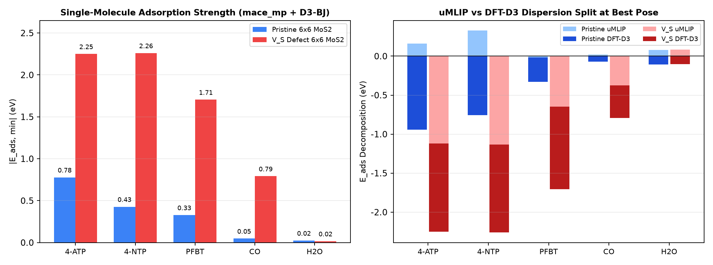

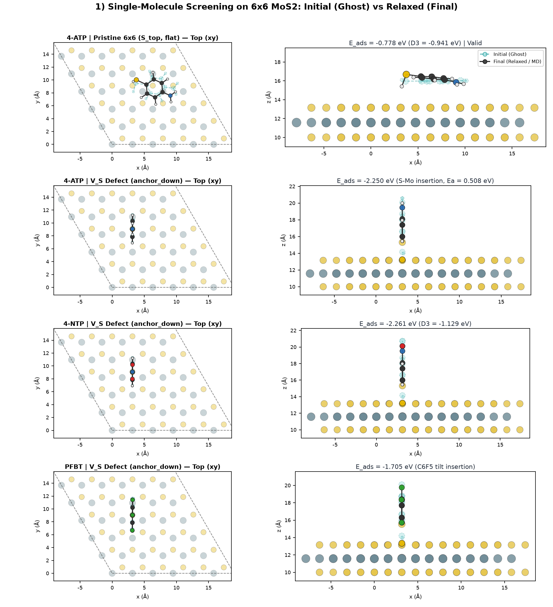

---

### Section 2. `6×6` Track A 저밀도(`77.8 Ų/mol`) & 디설파이드(`Ar–S–S–Ar`)
* `N1_monomer_flat`: `E_ads = -0.691 eV` (`E_sub = -0.707`, `E_lat = +0.016`)
* `N2_dimer_side_by_side`: `-0.735 eV/mol`, `N3_trimer_L_hbond`: `-0.743 eV/mol`
* `N4_monolayer_parallel` (`77.83 Ų/mol`): **`E_ads/mol = -0.634 eV`**, `E_lat = +0.002 eV`, `vac E_des = 0.641 eV` → 너무 넓어 측면 인력이 작동하지 못함.
* `disulfide_adsorbed`: `E_ads = -0.671 eV`, `2 RSH → RSSR + H₂` `+0.957 eV`, 산화 커플링(`+0.5 O₂ → H₂O`) **`-1.838 eV`**.

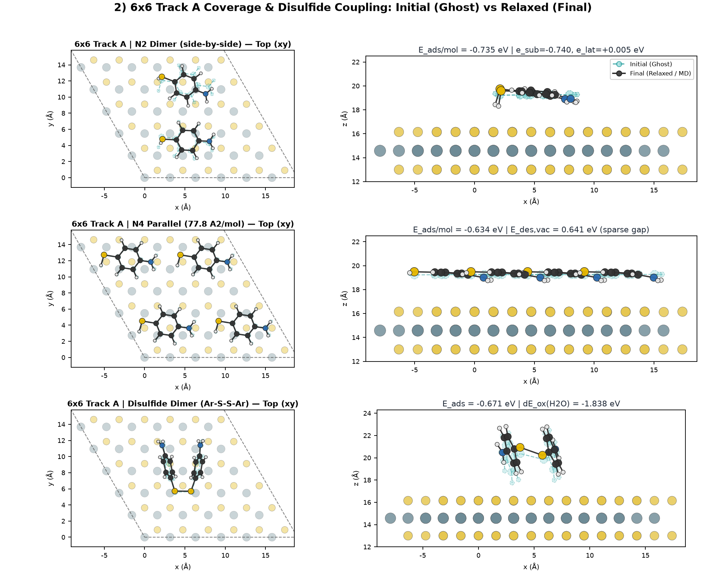

---

### Section 3. 슈퍼셀·밀도 스캔 (`51.9 ~ 77.8 Ų/mol`)

| 스캔 배치 | 셀 / `N` | 면적 (Ų/mol) | 최안정 케이스 | `E_ads/mol` | `E_sub` / `E_lat` | `E_des,vac` | 틸트 / 수렴 |
| :--- | :--- | :---: | :--- | :---: | :---: | :---: | :---: |
| `cell_scan_6x6_dense` | `6×6 / 4` | `77.83` | `N4_brick_canted_flat` | `-0.727` | `-0.690 / -0.037` | `0.446 eV` | `5.0°` / `True` |
| `cell_scan_6x6_dense` | `6×6 / 6` | `51.89` | `N6_3x2_flat` | `-0.814` | `-0.672 / -0.142` | `0.815 eV` | `12.1°` / `True` |
| `cell_scan_5x5_n4` | `5×5 / 4` | `54.05` | `N4_brick_flat` | `-0.813` | `-0.680 / -0.133` | `0.941 eV` | `19.6°` / `True` |
| **`cell_scan_6x5_n4`** | **`6×5 / 4`** | **`64.86`** | **`N4_2x2_flat`** | **`-0.800`** | **`-0.716 / -0.084`** | **`0.883 eV`** | **`6.2°` / `True`** |
| `cell_scan_8x8_n9` | `8×8 / 9` | `61.50` | `N9_3x3_canted_tilt20` | `-0.805` | `-0.715 / -0.090` | `0.841 eV` | `11.3°` / `False` |

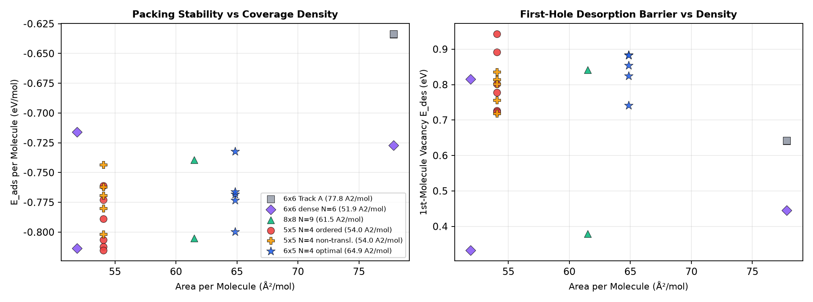

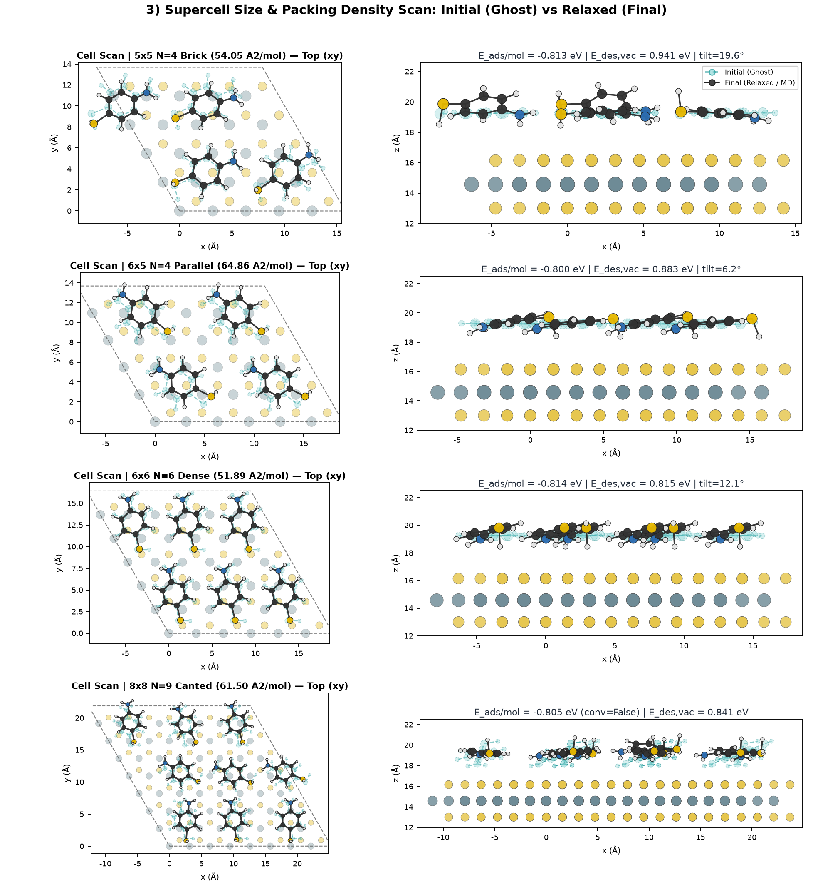

---

### Section 4. `5×5` 고밀도 (`54.05 Ų/mol`): 정적 · 비병진 · 기계적 안정성 · MD

* **정적 규칙/비병진**: `N1_monomer_flat` (`-0.753 eV`), `N4_brick_flat` (`-0.812 eV/mol`, `E_des,vac = 0.942 eV`), `N4_parallel_flat` (`-0.789 eV/mol`, `E_des,vac = 0.726 eV`), `N4_herringbone_T90` (`-0.802 eV/mol`, `E_des,vac = 0.802 eV`), `N4_disordered_flat` (`-0.769 eV/mol`, `E_des,vac = 0.836 eV`).
* **교란 & 시트 변형**: `N4_brick_flat`은 `0.10 Å` 교란 후 원위치(`RMSD = 0.037 Å`), `N4_parallel_flat`은 `0.362 Å` 이동. 단독 시트 압축 시(`54.05 → 48.78 Ų`) `E_lat`가 `-0.183 → -0.238 eV/mol`, `tilt 21.7° → 30.7°`로 꺾임.
* **3.0 ps 유한온도 MD (`mos2_5x5_4atp_md`)**: `N4_brick_333K` (`res=1.00`, `tilt=24.9°`), 반면 **`N4_brick_423K (150 °C)`에서는 `res = 0.900`, `max_dz = 5.15 Å`, `tilt = 36.3°`, `ΔE_quench = +0.620 eV`**로 과밀 반발 때문에 1분자가 수직으로 들려 튕김.

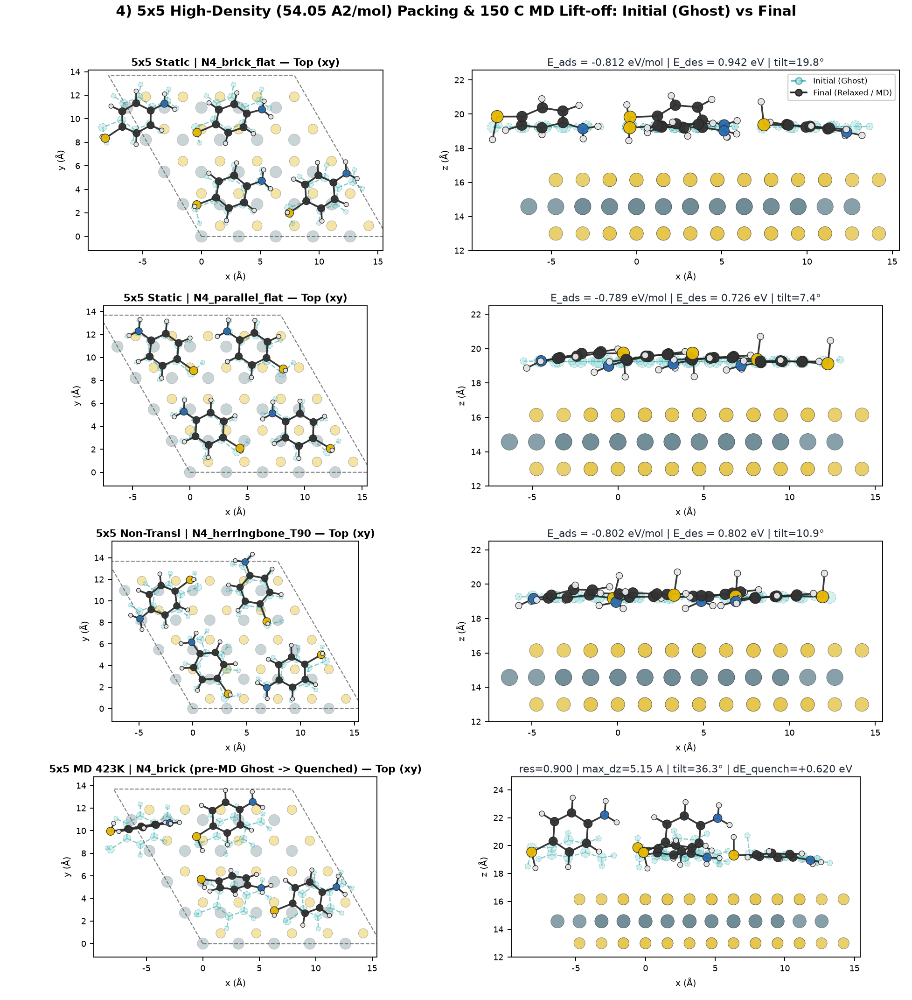

---

### Section 5. `6×5` 최적 중간 밀도 (`64.86 Ų/mol`): 정적 & 150 °C MD

* **정적 안정성**:
  * `N1_monomer_flat`: `E_ads = -0.718 eV`, `E_des = 0.718 eV` (`60 °C` $\tau_{1/2} = 0.0051\text{ s}$)
  * **`N4_parallel_flat`**: **`E_ads = -0.800 eV/mol`**, **`E_des,vac = 0.883 eV`** (`+0.165 eV`, `60 °C` $\tau_{1/2} = 1.58\text{ s}$ — **312배 증가**), `tilt = 6.2°`, 교란 RMSD `0.017 Å`
  * `N4_herringbone_T90` (`-0.768`, `E_des = 0.883 eV`), `N4_disordered_flat` (`-0.773`, `E_des = 0.854 eV`), `N4_brick_flat` (`-0.732`, `E_des = 0.741 eV`)
* **150 °C (423.15 K) MD**: `parallel`, `brick`, `disordered` 모두 **`res = 1.00`**, `mean_dz = 3.28–3.35 Å`, `MSD_xy = 1.91–3.29 Ų`, `ΔE_quench = +0.035 / -0.034 / -0.049 eV`로 평탄 2D 막 완전 유지.

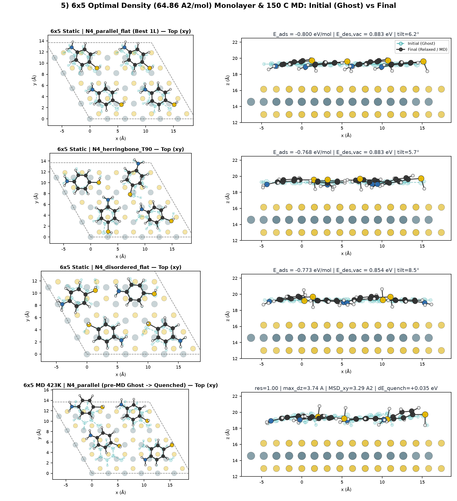

---

### Section 6. Track B: `6×5` 다층 적층 (`1L → 2L → 3L`) 정적 및 MD

* **정적 감쇠 (`mos2_6x5_4atp_multilayer`)**:
  * `1L` (`L1_N4_parallel`, `conv=True`): `E_ads = -0.800 eV/mol` (`e_mos2_direct = -0.722`), `E_des,vac = 0.883 eV`, `N=1` probe `0.718 eV`
  * `2L` (`L2_N4_AB_diag_anti`, `conv=True`): `E_ads = -0.640 eV/mol` (`e_mos2_direct = -0.102`, `e_lat = -0.086`, `tilt = 17.4°`, `hb_inter = 4`), `E_des,vac = 0.711 eV` (`60 °C` `3.96 ms` / `150 °C` `20.4 μs`), `N=1` probe `0.579 eV` (`L2_N1_bridge_anti`)
  * `3L` (`L3_N4_ABC_anti`, `conv=True`): `E_ads = -0.576 eV/mol` (`e_mos2_direct = -0.017`, `e_lat = -0.106`, `tilt = 18.4°`, `hb_inter = 2`), `E_des,vac = 0.625 eV` (`60 °C` `0.195 ms` / `150 °C` `1.90 μs`), `N=1` probe `0.522 eV` (`L3_N1_B_anti`)
* **다층 MD (`mos2_6x5_4atp_multilayer_md`, 3.0 ps)**:
  * `2L_best_333K` / `423K`: `res = 1.00`, 최상층 `dz = 6.12 / 6.18 Å`, 최상층 평균 틸트 `30.2° / 33.1°` (`max = 89.6° / 90.0°`), `hbonds = 5–6`, Quench `ΔE = -0.270 / -0.071 eV`
  * `3L_best_333K` / `423K`: `res = 1.00`, 최상층 `dz = 9.82 / 9.96 Å`, 최상층 틸트 `22.9° / 23.6°`, `max_dz_drift = 1.26 / 1.59 Å`, 최상층 `MSD_xy = 2.28 / 2.54 Ų`

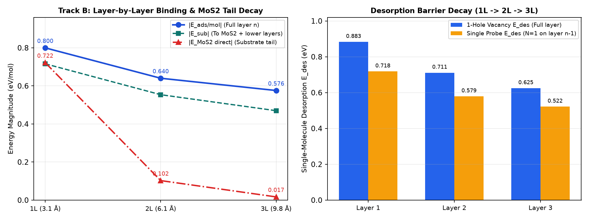

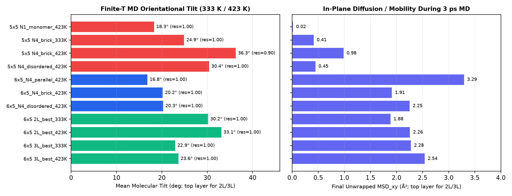

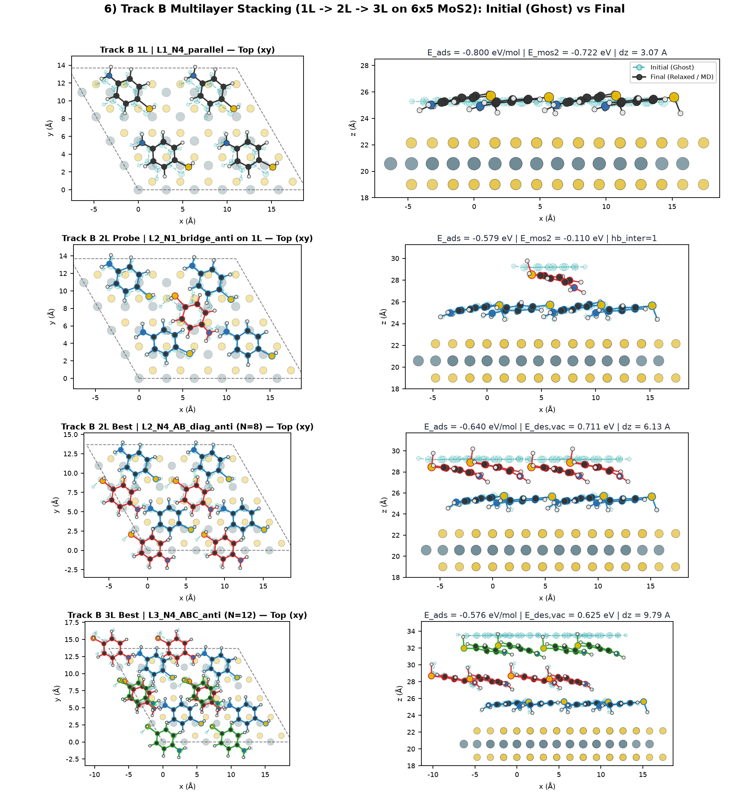

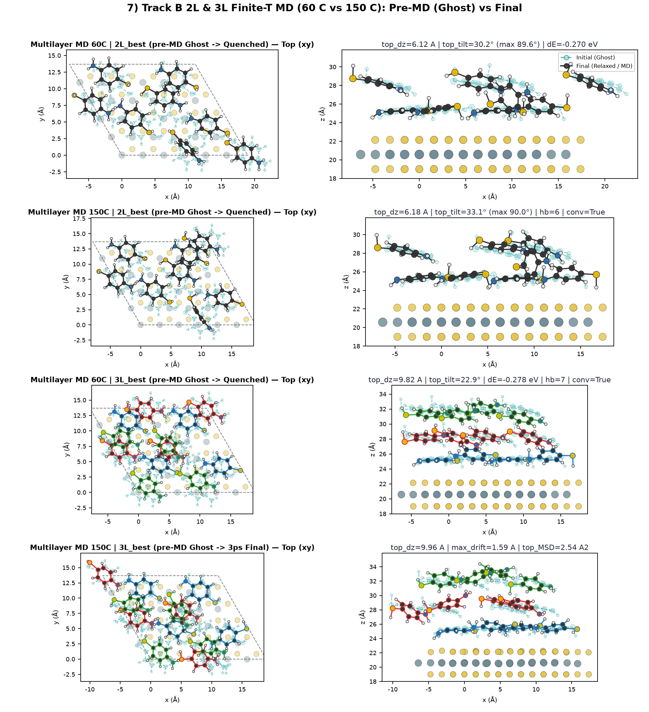

---

### Section 7. 고체 4-ATP ($Pca2_1$) 벌크 결정 & 고밀도 틸트(`N=6, 43.24 Ų`) 2·3층 비교

#### A. 벌크 $Pca2_1$ 결정 (`4atp_bulk_pca21`)
| 케이스 | 격자 (`a, b, c`, Å) / 밀도 | `E_coh/mol` (eV) | `uMLIP` / `D3` | 결합 상태 | 수렴 |
| :--- | :---: | :---: | :---: | :--- | :---: |
| `neutral_cand_2_fixed` | `(11.23, 6.10, 8.28)` / `1.47` | `-0.634` | `+0.278` / `-0.913` | `SH=4, NH=8` (중성) | `True` |
| `neutral_cand_2_cellopt` | `(11.58, 6.29, 8.58)` / `1.33` | **`-0.681`** | `+0.094` / `-0.775` | `SH=4, NH=8` (중성) | `True` |
| `neutral_cand_3_fixed` | `(11.23, 6.10, 8.28)` / `1.47` | **`-0.773`** | `+0.139` / `-0.912` | **`SH=0, NH=12`** (`d_NS=3.14 Å`, **자발적 양성이온**) | `True` |
| `neutral_cand_3_cellopt` | `(11.73, 6.82, 8.26)` / `1.26` | **`-1.038`** | `-0.334` / `-0.704` | **`SH=0, NH=12`** (`C-H=16`, `d_NS=3.02 Å`) | `True` |

* **결함 및 `(001)` 결정 표면 탈착** (`neutral_cand_3_cellopt`): `1×2×2` 벌크 1공공 제거 `E_des,bulk = 1.993 eV`, **`(001)` 표면 1분자 탈착 `E_des,surf = 1.139 eV`** ($\gamma = 0.0089\text{ eV/\AA}^2$, `conv=True`).

#### B. 평평한 `1L` 위 틸트·고밀도(`43.24 Ų/mol`) `2L/3L` (`mos2_6x5_4atp_tilted_multilayer`)
* `L2_N4_tilt45_anti`: `E_ads = -0.622 eV/mol` (`tilt 24.7°`, `conv=False`, `fmax=0.046`)
* `L2_N4_herringbone_t45`: `E_ads = -0.573 eV/mol` (`tilt 15.0°`, `conv=True`)
* `L2_N6_tilt45_anti` (`43.24 Ų/mol`): **`E_ads = -0.584 eV/mol`** (`e_lat = -0.212`, `e_sub = -0.371`, `conv=False`, `fmax=0.057`) → **1홀 탈착 `vac = 0.693 eV` (`conv=True`)**
* `L3_N6_tilt45_par`: `-0.482 eV/mol` (`conv=False`, `vac = -0.341 eV` 불안정)
* **물리 결론**: 평평한 `1L` 위에서 밀도를 `43.2 Ų/mol`까지 높여 세우면 층내 인력(`e_lat`)은 2.5배 강해지지만(`-0.086 → -0.212 eV`), `1L` 바닥과의 면접촉(`e_sub`) 손해(`-0.554 → -0.371 eV`) 때문에 평탄 엇갈림 `AB_diag_anti` (`-0.640 eV/mol`)를 넘어서지 못합니다. 반면 두께가 더 커져 **벌크 양성이온 `Pca2₁` (`-0.773 ~ -1.038 eV/mol`, 융점 ~40–46 °C)**로 결정화할 수 있는 **RT**에서는 3D 섬(`7–10 nm`) 성장이 가능하고, **40–60 °C 이상**에서는 벌크 결정 상이 녹거나 중성 2·3층 반감기(`ms–μs`)에 걸려 억제됩니다.

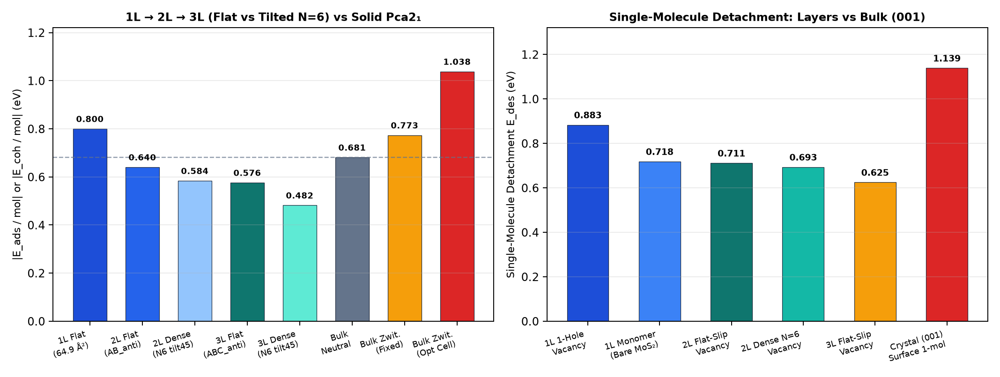

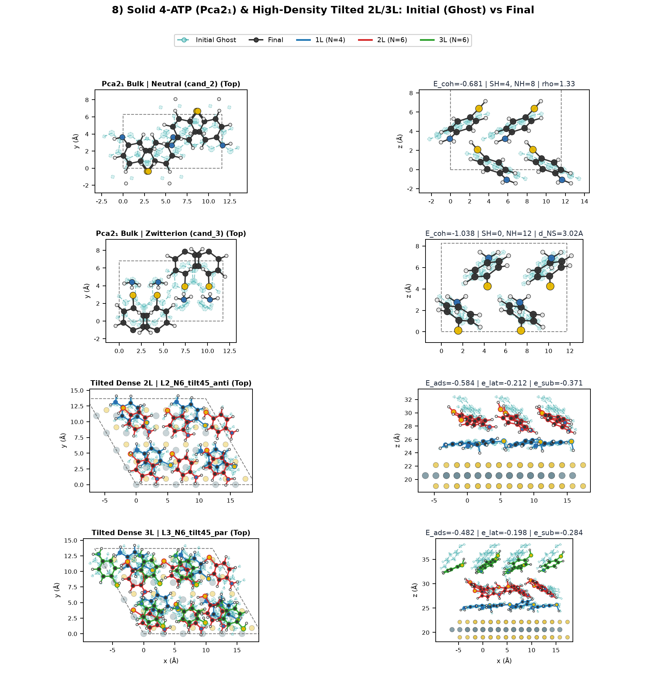
