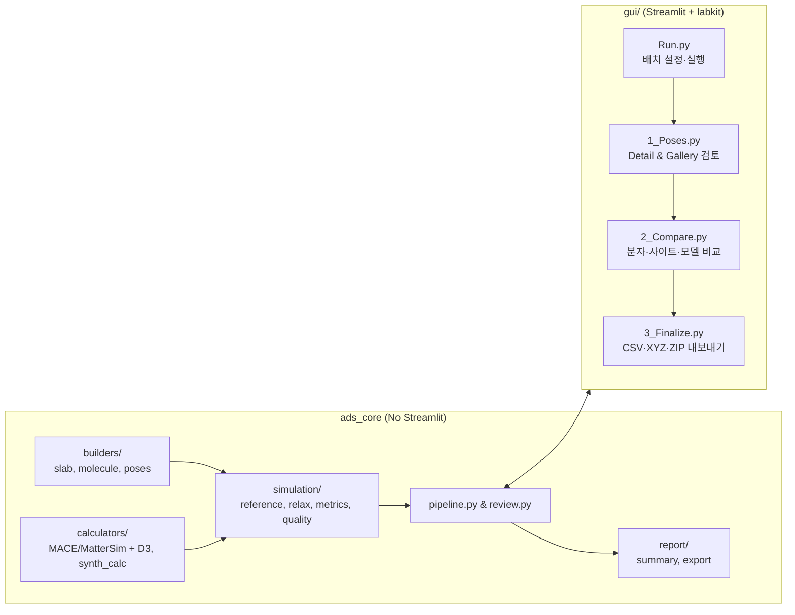

# MoS2_adsorption_sim 설계 및 과학적 보완 계획서

이 문서는 처음 작성된 **"로컬 PC 기반 $\text{MoS}_2$ 표면–분자 흡착 에너지 시뮬레이션 가이드 (uMLIP + DFT-D3)"**를 바탕으로, 연구실 공통 원칙([`../AGENTS.md`](../../AGENTS.md))에 맞춰 **논문·연구 수준의 과학적 타당성을 확보하기 위해 보완한 물리적 설계**와 **기존 UI·코어 아키텍처 재사용 계획**을 정리한 문서다.

---

## 1. 과학적 의미를 갖기 위한 6가지 핵심 보완

기본 가이드의 핵심 아이디어(`ASE` + `uMLIP(MACE/MatterSim)` + `torch-dftd`의 `SumCalculator` 결합)는 매우 정확하다. 다만 실제 연구에서 단순 스크립트 실행에 그치지 않고 **신뢰할 수 있는 정량적 스크리닝 데이터**를 얻으려면 아래 6가지 물리적 문제가 해결되어야 한다.

### 1.1. 기준 에너지($E_{\text{slab}}, E_{\text{mol}}$)의 자체 일관성 (Self-Consistency)
* **문제:** $E_{\text{ads}} = E_{\text{slab+mol}} - (E_{\text{slab}} + E_{\text{mol}})$에서 초기(unrelaxed) 구조의 에너지를 쓰거나, 서로 다른 계산 설정의 에너지를 빼면 수백 meV 이상의 오차가 발생해 물리흡착($-0.1 \sim -0.5\text{ eV}$) 판정이 무의미해진다.
* **보완 설계:**
  * `slab`(깨끗한 또는 결함이 있는 $\text{MoS}_2$ 슈퍼셀)과 `mol`(큰 진공 박스에 놓인 고립 기체 분자)도 **반드시 동일한 `SumCalculator`(uMLIP + DFT-D3)와 동일한 힘 수렴 기준(`fmax`)으로 먼저 자체 이완**한다.
  * 배치 실행 시 `(surface_id, calculator_id)`별 $E_{\text{slab}}$과 `(molecule_id, calculator_id)`별 $E_{\text{mol}}$을 먼저 구해 캐시하고, 모든 흡착 포즈는 이 기준값을 공유한다.

### 1.2. 반데르발스(DFT-D3) 기여도의 정량적 분리 ($E_{\text{ads}}^{\text{uMLIP}}$ vs $E_{\text{ads}}^{\text{D3}}$)
* **문제:** `SumCalculator`의 합산 에너지만 보면, 인력이 순수 분산력(vdW) 때문인지 전하 이동·궤도 혼성에 의한 화학적 결합 때문인지 구분할 수 없다.
* **보완 설계:**
  * 이완이 완료된 최종 구조에서 기본 uMLIP 계산기와 DFT-D3 계산기를 각각 단점(single-point) 평가하여 흡착 에너지를 두 성분으로 분해한다:
    $$E_{\text{ads}} = E_{\text{ads}}^{\text{uMLIP}} + E_{\text{ads}}^{\text{D3}}, \quad f_{\text{vdW}} = \frac{E_{\text{ads}}^{\text{D3}}}{E_{\text{ads}}}$$
  * **해석적 가치:**
    * 기저면(basal plane) 물리흡착에서는 $E_{\text{ads}}^{\text{uMLIP}} \approx 0$ (또는 약한 양수 반발)이고 $E_{\text{ads}}^{\text{D3}} < 0$이 지배적($f_{\text{vdW}} \ge 0.7$)임을 수치로 증명할 수 있다.
    * 황 공공($\text{V}_{\text{S}}$) 결함 사이트에서의 화학흡착은 $E_{\text{ads}}^{\text{uMLIP}}$ 자체가 큰 음수를 갖는 것으로 명확히 대비된다.

### 1.3. 변형 에너지(Deformation / Strain Energy) 분해
* **문제:** 흡착 후 분자나 $\text{MoS}_2$ 격자가 크게 휘어지거나 결합 길이가 늘어나는 경우, 순수 결합력($E_{\text{int}}$)은 매우 강하지만 구조 변형 비용($E_{\text{def}} > 0$) 때문에 겉보기 $E_{\text{ads}}$가 작게 보일 수 있다.
* **보완 설계:**
  * 이완 완료된 `slab+mol` 좌표에서 원자만 분리하여 추가 이완 없이 단점 에너지를 2회 계산한다:
    $$E_{\text{def, slab}} = E_{\text{slab}}(\text{in complex}) - E_{\text{slab}}(\text{free})$$
    $$E_{\text{def, mol}} = E_{\text{mol}}(\text{in complex}) - E_{\text{mol}}(\text{free})$$
    $$E_{\text{int}} = E_{\text{ads}} - \left( E_{\text{def, slab}} + E_{\text{def, mol}} \right)$$
  * 단점 계산 2회(소요 시간 1초 미만)만으로 **ALD 전구체 활성화 여부(분자 변형 에너지 증가)**와 **표면 격자 왜곡 정도**를 정량화할 수 있다.

### 1.4. 다중 초기 배치(Multi-Pose Ensemble) 샘플링과 볼츠만 통계
* **문제:** BFGS/FIRE 구조 이완은 국소 최적화(local optimization)이므로, 분자를 처음 어디에 어떤 각도로 놓았는지에 따라 결과가 달라진다. 임의의 한 점에만 놓고 계산한 $E_{\text{ads}}$는 대표성이 없다.
* **보완 설계:**
  * **표면 대칭 사이트 자동 지정:**
    * 무결함 2H-$\text{MoS}_2$: `Mo_top`, `S_top`, `Hollow`, `Bridge`
    * 결함 2H-$\text{MoS}_2$: 단일 황 공공(`V_S`), 이중 황 공공(`V_S2`) 중심 및 인접 사이트
  * **분자 배향(Orientation) 자동 생성:** 분자 관성 모멘트 주축(principal axes)을 정렬하여 수평(`flat`), 수직 위/아래(`upright_up`, `upright_down`), 평면 내 회전($0^\circ, 60^\circ$) 포즈를 체계적으로 생성한다.
  * **대표값 이원화:**
    1. 최안정 에너지 $E_{\text{ads, min}} = \min_i E_{\text{ads}, i}$ 및 선호 사이트(`best_site`)
    2. 온도 $T$(기본 $300\text{ K}$)에서의 볼츠만 가중 평균:
       $$\langle E_{\text{ads}} \rangle_T = \sum_i p_i E_{\text{ads}, i}, \quad p_i = \frac{\exp(-E_{\text{ads}, i} / k_{\text{B}} T)}{\sum_j \exp(-E_{\text{ads}, j} / k_{\text{B}} T)}$$
    3. 사이트 간 에너지 편차($\Delta E_{\text{corrugation}} = E_{\text{ads, max}} - E_{\text{ads, min}}$): 표면 확산(surface diffusion) 장벽의 하한선 지표로 활용한다.

### 1.5. 구조 무결성(Integrity) 및 품질 자동 판정 (`valid` / `attention` / `invalid`)
* **문제:** uMLIP 이완 중 초기 거리가 너무 가까우면 비물리적 원자 충돌이나 해리가 일어날 수 있고, 너무 멀면 분자가 진공으로 날아간 채 수렴(`fmax` 달성)될 수 있다.
* **보완 설계:**
  * 기하 지표(`d_min_A`, `dz_com_A`, `max_bond_stretch_pct`, `slab_rmsd_A`)를 자동 계산하여 3단계 상태로 분류한다.
  * 미수렴(`not_converged`), 원자 겹침(`atomic_overlap`), 기저면 위 비정상 해리(`unexpected_dissociation`)는 `invalid`로 처리해 요약 통계에서 자동 제외한다.
  * 진공 이탈(`desorbed_to_vacuum`), 반발(`repulsive_adsorption`), 결함 위 해리 흡착 후보(`dissociation_candidate`)는 `attention`으로 올려 연구자가 `1_Poses` 페이지에서 원자 배치 그림을 보고 `Approve` 또는 `Reject`를 결정하게 한다.

### 1.6. 1D 포텐셜 에너지 곡선 ($E(z)$ Binding Curve) 및 모델 교차 검증
* **보완 설계:**
  * 특정 사이트 위에서 분자를 수직 방향($\Delta z = 1.8 \sim 8.0\text{ \AA}$)으로 옮기며 단점(또는 조건부) 에너지를 계산하는 **1D 결합 곡선 스캔**을 지원한다.
  * 이 곡선에서 **uMLIP 단독 곡선(인력 우물 없음)**과 **uMLIP + DFT-D3 곡선(명확한 평형 거리와 인력 우물 형성)**을 겹쳐 그리면, 왜 DFT-D3 보정이 필수인지 직관적으로 검증할 수 있다.
  * 동일 포즈 세트를 `MACE-MP-0 + D3`와 `MatterSim + D3`로 각각 실행해 모델 간 경향성 일치 여부를 `2_Compare` 페이지에서 바로 비교한다.

---

## 2. 아키텍처 및 UI 재사용 설계

측정 데이터 분석 프로그램(`FET_analysis`)과 시뮬레이션 프로그램(`MoS2_adsorption_sim`)의 역할 대응표는 다음과 같다.

### 2.1. 그대로 재사용하는 공용 모듈 (`labkit/`)
1. **`labkit/plot_theme.py`**
   - 모든 그래프에 `apply_paper_layout` / `finish_figure` 적용 (Arial 14, 흰 바탕, 사방 테두리 축, 안쪽 눈금).
   - 색 역할 이름 사용:
     - `DATA`: 총 에너지 곡선, 기본 측정/계산 값
     - `FIT`: DFT-D3 보정 성분 또는 기준 평면 표시선
     - `AUX`: uMLIP 단독 성분(보정 전), 초기 포즈 위치(이완 전 고스트 표시), 제외된(`rejected`) 포즈
     - `MARK`: 평형 위치(최저 에너지 점), 최단 원자간 거리(`d_min`) 연결선
     - `STATUS_COLORS`: Gallery 패널 테두리/제목 및 상태 표시 (`valid` / `attention` / `invalid`)
     - `CATEGORICAL`: 분자 종류별, 표면 사이트별(`Mo_top`, `S_top`, `Hollow`, `V_S`), 계산기 종류별 색상
2. **`labkit/sidebar.py`**
   - 모든 페이지 사이드바는 `sidebar_section("1) Batch")`, `sidebar_section("2) Filters")`, `sidebar_section("3) Figure size")`로만 구성한다.
3. **`labkit/figure_size.py`**
   - 모든 그래프는 `show_figure(fig, size, filename=...)`로 그리며, 사이드바에서 가로·세로(px), 격자(`Grid`), 저장 형식(`png`/`svg`, 3배 해상도)을 제어한다.

### 2.2. `FET_analysis`에서 가져오는 구조적 패턴
1. **엄격한 설정(`ads_core/config.py` + `config.yaml`):**
   - $\text{MoS}_2$ 격자 상수($a = 3.16\text{ \AA}$, S–S 두께 등), 기본 슈퍼셀 크기($4\times4\times1$), 진공층 두께($20.0\text{ \AA}$), 초기 높이 목록, `fmax` 기준($0.03\text{ eV/\AA}$), `max_steps`($200$), D3 파라미터(`xc: pbe`, `damping: bj`), 품질 판정 임계값 등을 모두 한국어 주석이 달린 `config.yaml`에 둔다.
   - 코드 내 기본값을 두지 않으며, `test_every_config_key_is_read` 테스트로 죽은 설정 키를 방지한다.
2. **비파괴적 검토(`ads_core/review.py` → `review.json`):**
   - 시뮬레이션 원시 결과(`raw_results.json`)는 수정하지 않는다.
   - 사용자가 `1_Poses`에서 누르는 `Approve` / `Reject` / `Clear`, 메모, `2_Compare`에서 바꾸는 분자·그룹 표시 이름과 순서는 즉시 `review.json`에 저장된다.
3. **단위 테스트용 합성 계산기(`ads_core/calculators/synth_calc.py`):**
   - `FET_analysis`가 `fet_core/synth.py`(정답을 아는 합성 transfer 곡선)로 실제 장비 파일 없이 모든 분석 로직을 검증하듯, `MoS2_adsorption_sim`은 **해석적 2D 표면 포텐셜(Morse/Lennard-Jones + 대칭 사이트 corrugation + D3 모사 항)**을 제공하는 `SynthAdsorptionCalculator`를 내장한다.
   - 덕분에 무거운 PyTorch/MACE 가중치나 GPU가 없는 CI/테스트 환경에서도 수 초 안에 구조 이완, 에너지 분해, 품질 판정, CLI, Streamlit 4개 페이지 전체를 100% 자동 테스트할 수 있다.

### 2.3. 원자·분자 및 물리적 상황 시각화 설계 (검증된 전용 라이브러리 조합)

원자와 분자, 결정 격자를 밑바닥부터 직접 좌표 계산해 그리지 않고, 역할별로 검증된 재료과학·화학 전용 시각화 도구를 조합한다.

| 역할 | 사용하는 도구 | 구현 내용 |
| --- | --- | --- |
| **흡착 사이트 자동 탐색 및 2D 사이트 지도** | **`pymatgen.analysis.adsorption`** (`AdsorbateSiteFinder`, `plot_slab`) | • 무결함 슬랩의 대칭 사이트(`ontop`, `bridge`, `hollow`)를 대칭성 기반으로 자동 탐색 • `plot_slab(slab, ax, adsorption_sites=True)`로 표면 원자와 사이트 위치를 자동 렌더링 |
| **대화형 3D 구조 및 이완 궤적 애니메이션 (`1_Poses` Detail)** | **`py3Dmol`** (3Dmol.js WebGL, `st.components.v1.html` 임베딩) | • $\text{MoS}_2$ 슬랩(반투명 sphere/stick + `addUnitCell()` 경계 박스)과 흡착 분자(선명한 Jmol Ball-and-Stick)를 계층 분리해 렌더링 • **이완 전 Ghost 비교:** 초기 배치 구조를 반투명 모델로 겹쳐 표시 • **최단 거리(`d_min`) 표시:** `addCylinder(dashed=True)` 및 `addLabel()`로 가장 가까운 표면–분자 원자 쌍과 거리($\text{\AA}$) 표시 • **이완 궤적 재생:** `addModelsAsFrames(xyz_traj)` + `animate()`로 Step $0 \to N$ 동안 분자가 표면으로 끌려와 안착하는 과정을 애니메이션으로 재생 |
| **빠른 2D 정투영 썸네일 (`1_Poses` Gallery 및 정적 도면)** | **`ase.visualize.plot.plot_atoms`** (`ase` 내장) | • `plot_atoms(atoms, ax, rotation="0x,0y,0z")`로 Top view($xy$), `rotation="-90x,0y,0z"`로 Side view($xz$)를 원소별 반지름·색상·깊이 정렬을 포함해 즉시 생성 |
| **수렴 곡선·결합 곡선·비교 통계 그래프 (`1_Poses`, `2_Compare`)** | **`labkit` + Plotly** (`plot_theme.py`, `figure_size.py`) | • 이완 스텝별 $\Delta E$ 및 $F_{\max}$ 수렴 곡선(목표 `fmax` 기준선 포함) • 1D 수직 결합 곡선($E(\Delta z)$ vs $\Delta z$: 총 에너지 `DATA`, uMLIP 단독 `AUX`, DFT-D3 `FIT`) • 분자·사이트·결함별 $E_{\text{ads}}$ 비교(box + 점) 및 에너지 분해 누적 막대그래프($E_{\text{ads}}^{\text{uMLIP}}$ vs $E_{\text{ads}}^{\text{D3}}$, $E_{\text{int}}$ vs $E_{\text{def}}$) |

---

### 2.4. 화면별 세부 설계 (`gui/`)

1. **`gui/Run.py` (시뮬레이션 설정 및 실행)**
   - **배치 선택 및 생성:** 기존 시뮬레이션 배치 불러오기 또는 새 배치 만들기.
   - **표면 설정:** 슈퍼셀 크기($n_x \times n_y$), 진공층 두께($\text{\AA}$), 결함 옵션(`pristine`, `V_S` 단일 황 공공, `V_S2` 이중 황 공공), 하부 원자 고정 옵션(`fix_bottom_layer`).
   - **분자 선택:** 내장 프리셋 분자($\text{H}_2\text{O}$, $\text{NH}_3$, $\text{CO}$, $\text{O}_2$, $\text{TMA}[\text{Al(CH}_3)_3]$, $\text{TDMAA}$ 등) 다중 선택 또는 사용자 `.xyz`/`.mol` 파일 업로드.
   - **포즈 및 계산기 설정:** 대칭 사이트 선택(`Mo_top`, `S_top`, `Hollow`, `Bridge`, `Defect`), 배향 프리셋, 계산기 선택(`mace_mp`, `mattersim`, `synth_morse`), DFT-D3 켜기/끄기, `fmax` 및 `max_steps` (`Advanced` expander).
   - **실행:** `Run Simulation Batch` 버튼 클릭 시 진행률 표시줄과 함께 포즈별 이완을 수행하고 결과를 `data/results/<배치>/`에 저장. (WSL2 터미널에서 실행할 수 있는 동일한 CLI 명령줄도 화면에 함께 안내).

2. **`gui/pages/1_Poses.py` (개별 포즈 검토 및 구조·수렴 확인)**
   - **`Detail` 탭:**
     - 왼쪽: 필터링된 포즈 목록(`attention` 상태가 맨 위, 현재 선택된 행에 `▶` 표시).
     - 오른쪽 상단(2열 그래프):
       - 왼쪽 그림: **원자 배치 Top & Side 투영도 (Plotly 2D/3D 선택 가능, 기본은 논문용 정량 비교에 유리한 Top view + Side view 2패널 도면)** — $\text{MoS}_2$ 격자(Mo, S), 결함 위치, 이완 전 초기 분자 위치(`AUX` 회색 점선), 이완 후 분자 위치, 최단 거리 `d_min_A` 연결선(`MARK` 주황선) 표시.
       - 오른쪽 그림: **구조 이완 수렴 곡선** — 스텝에 따른 상대 에너지 변화 $\Delta E(\text{step})$ 및 최대 힘 $F_{\max}(\text{step})$ (수평 기준선으로 목표 `fmax` 표시).
     - 오른쪽 중단: `Approve` / `Reject` / `Clear` 버튼(즉시 저장 후 다음 포즈로 이동) 및 메모 입력란.
     - 오른쪽 하단: 선택한 포즈의 에너지 분해 표($E_{\text{ads}}$, $E_{\text{ads}}^{\text{uMLIP}}$, $E_{\text{ads}}^{\text{D3}}$, $f_{\text{vdW}}$, $E_{\text{int}}$, $E_{\text{def, slab}}$, $E_{\text{def, mol}}$) 및 기하 지표 표(`d_min_A`, `dz_com_A`, `tilt_deg`, `max_bond_stretch_pct`, `slab_rmsd_A`).
   - **`Gallery` 탭:**
     - 모든 포즈의 작은 Top/Side 구조 또는 수렴 곡선을 상태별 색상(`STATUS_COLORS`) 격자로 표시하고, 패널을 클릭하면 해당 포즈의 `Detail` 보기로 즉시 이동.

3. **`gui/pages/2_Compare.py` (분자·사이트·결함·모델 비교)**
   - **Tab 1 — `Metrics & Sites`:**
     - 분자별·표면(Pristine vs $\text{V}_{\text{S}}$)별 $E_{\text{ads}}$, $d_{\text{min}}$, $\Delta z_{\text{COM}}$, $f_{\text{vdW}}$ 분포(box + 사이트별 점)를 2열로 표시.
     - 사이트별 선호도 비교(같은 분자 내에서 `Mo_top`, `S_top`, `Hollow`, `Bridge`, `V_S` 간 에너지 비교).
   - **Tab 2 — `Energy Decomposition & Binding Curves`:**
     - 분자별 최안정 포즈의 에너지 성분 누적 막대그래프($E_{\text{ads}}^{\text{uMLIP}}$ vs $E_{\text{ads}}^{\text{D3}}$, 그리고 $E_{\text{int}}$ vs $E_{\text{def}}$).
     - 1D 결합 곡선($E(\Delta z)$ vs $\Delta z$) overlay 그래프 (D3 보정 전/후 비교 또는 분자 간 비교).
   - **Tab 3 — `Summary Table & Groups`:**
     - 그룹별 통계 표 및 표시 이름·순서 편집(즉시 `review.json`에 반영).

4. **`gui/pages/3_Finalize.py` (최종 확정 및 내보내기)**
   - `(표면, 분자, 계산기)`별 최안정 포즈($E_{\text{ads, min}}$, `best_site`)와 $300\text{ K}$ 볼츠만 평균($\langle E_{\text{ads}} \rangle$) 요약 표 확인.
   - `Export Results` 버튼으로 Origin 호환 CSV(`poses_summary.csv`, `molecule_summary.csv`, `relaxation_curves/`, `binding_curves/`), VESTA/Ovito에서 바로 열 수 있는 이완 완료 구조 파일(`structures/*.xyz`, `*.cif`), 재현성 메타데이터(`run_metadata.json`) 생성 및 `.zip` 다운로드.

---

## 3. 단계별 구현 계획 (Roadmap)

각 단계가 끝날 때마다 단위 테스트(`pytest`)를 통과시키고 `docs/DEV_LOG.md`에 검증 결과를 기록한다.

### 0단계: 프로젝트 뼈대 및 계획 수립 (현재 단계)
- `MoS2_adsorption_sim/` 폴더 생성
- `AGENTS.md`, `docs/PLAN.md`, `README.md` 작성

### 1단계: 설정(`config.yaml`), 표준 모델, 구조·포즈 생성기 (`builders/`)
- `config.yaml` 및 엄격한 로더 `ads_core/config.py` 구현 (`test_every_config_key_is_read` 포함)
- `ads_core/model.py`: `SlabSpec`, `MoleculeSpec`, `PoseSpec`, `PoseResult`, `WarningRecord` 정의
- `ads_core/builders/slab.py`: ASE 기반 2H-$\text{MoS}_2$ 슈퍼셀 생성, 진공층 설정, 황 공공(`V_S`, `V_S2`) 생성, 하부 층 고정(`FixAtoms`)
- `ads_core/builders/molecule.py`: 주요 전구체·흡착 분자 내장 프리셋($\text{H}_2\text{O}$, $\text{NH}_3$, $\text{CO}$, $\text{O}_2$, $\text{CH}_4$, $\text{TMA}[\text{Al(CH}_3)_3]$ 등) 및 외부 `.xyz`/`.mol` 파일 파서
- `ads_core/builders/poses.py`: 대칭 사이트 좌표 계산 및 분자 주축 정렬·회전·초기 높이 배치를 통한 다중 `PoseSpec` 생성
- **검증:** 생성된 슬랩의 화학량론, 결함 원자 개수, 초기 포즈의 최단 거리 및 대칭 사이트 좌표 정확성 `pytest` 검증

### 2단계: 계산기 팩토리(`SumCalculator`), 구조 이완, 에너지 분해 및 품질 판정 (`calculators/`, `simulation/`)
- `ads_core/calculators/synth_calc.py`: 정답(평형 높이, 사이트별 결합 에너지, vdW 기여분)을 아는 해석적 ASE Calculator 구현
- `ads_core/calculators/factory.py`: `mace_mp`, `mattersim`, `synth_morse` 선택 및 `torch-dftd`(`TorchDFTD3Calculator`)와의 `SumCalculator` 결합 래퍼 구현 (패키지 미설치 시 명확한 안내 메시지)
- `ads_core/simulation/reference.py`: 슬랩 단독 및 진공 분자 단독 이완·캐시
- `ads_core/simulation/relax.py`: 포즈별 BFGS/LBFGS 구조 이완, 스텝별 궤적 기록, 1D 높이 스캔($E(z)$)
- `ads_core/simulation/metrics.py` & `quality.py`: $E_{\text{ads}}$, uMLIP/D3 분해, 변형 에너지($E_{\text{def}}$) 분해, 기하 지표 추출, `valid`/`attention`/`invalid` 판정
- **검증:** 합성 계산기에서 알려진 정답 에너지($E_{\text{ads}}$, $E_{\text{ads}}^{\text{D3}}$, 평형 거리 $z_{\text{eq}}$)가 $10^{-3}\text{ eV}$ 및 $10^{-2}\text{ \AA}$ 이내로 복원되는지, 미수렴·원자 충돌·진공 이탈 케이스가 정확한 사유 코드로 분류되는지 `pytest` 검증

### 3단계: 배치 파이프라인, `review.json`, 요약·내보내기, CLI (`pipeline.py`, `report/`, `cli.py`)
- `ads_core/review.py`: 포즈별 결정(`auto`/`approved`/`rejected`), 메모, 그룹 표시 이름·순서 저장/로드
- `ads_core/pipeline.py`: 배치 실행 및 디스크 저장/로드, `poses_frame` 및 `molecules_frame` 생성
- `ads_core/report/summary.py` & `export.py`: 최안정 포즈 및 볼츠만 가중 평균 계산, Origin용 CSV, `.xyz` 구조 파일, `run_metadata.json` 출력
- `ads_core/cli.py` & `__main__.py`: WSL2 터미널에서 바로 배치 스크리닝을 돌릴 수 있는 CLI (`python -m ads_core`)
- **검증:** CLI 실행 및 내보내기 파일 계약 전체 `pytest` 검증

### 4단계: Streamlit GUI (`Run`, `1_Poses`, `2_Compare`, `3_Finalize`) 및 `labkit` 통합
- `gui/state.py`, `gui/components/figures.py`, `gui/components/values.py` 작성
- `gui/Run.py`, `gui/pages/1_Poses.py`, `2_Compare.py`, `3_Finalize.py` 구현
- **검증:** `tests/test_gui.py`로 모든 페이지 렌더링, 사이드바 구획 규칙, `labkit` 그래프 크기·테마 적용, `Approve`/`Reject` 즉시 저장, 내보내기 동작 자동 검증

### 5단계: 실제 uMLIP(MACE / MatterSim + DFT-D3) 벤치마크 및 1D 결합 곡선 검증
- WSL2 GPU/CPU 환경에서 실제 `mace-torch` / `mattersim` + `torch-dftd`로 기준 분자($\text{H}_2\text{O}$, $\text{NH}_3$, $\text{TMA}$ 등) on Pristine vs $\text{V}_{\text{S}}$ $\text{MoS}_2$ 스크리닝 수행 및 문헌 DFT 경향성과 비교 기록
